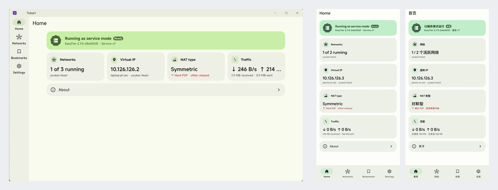

<p>
  <h1>Yukari</h1>
  
</p>

<p>
  <a href="https://github.com/SimonShiki/yukari/actions/workflows/ci.yml"></a>
  <a href="https://github.com/SimonShiki/yukari/releases"></a>
  <a href="./LICENSE"></a>
  
</p>

[English](./README.md) | 简体中文

Yukari 是基于 [EasyTier](https://github.com/EasyTier/EasyTier) 构建的，跨平台的去中心化组网应用，以随时随地连接你的设备。

在保留 EasyTier 完整功能的同时，我们在用户体验设计上进行了一些优化，以尽可能降低使用该工具组网的难度。

## 截图

<p align="center">
  
</p>

## 功能

- **跨平台支持** 目前 Yukari 支持 Windows、Linux 和 Android。苹果系统的支持在计划当中。
- **作为系统服务运行** 我们支持以系统服务的方式运行网络，以让虚拟网络能脱离 App 本身运行。在 Android 上，服务模式依赖 KernelSU 或 Magisk 模块。
- **轻松组网** 跟着提示一步步操作，应用会帮你搭建和管理网络。
- **完整的 EasyTier 功能** 本项目尽力包含了所有当前 EasyTier 支持的功能，并以一种更友好的方式呈现给使用者。我们同样保持了与原有 EasyTier 的兼容性。
- **快速分享** 除了正常的文件导出外，你还可以将网络或共享节点以二维码的方式分享给其他人。

## 安装

请前往 [Releases](https://github.com/SimonShiki/yukari/releases) 页面下载对应平台的安装包。

## 从源码构建

```bash
flutter pub get
flutter gen-l10n
flutter build linux --release       # or windows, or apk
```

EasyTier 原生库不需要额外安装工具链。打包时，脚本会从 `natives` 发布页下载与当前源码一致的原生库；只有找不到匹配的发布版本时，才会在本地编译 EasyTier，这时需要安装 xmake 和 Rust。

在 Linux 上，构建项目和运行 `flutter test` 都需要先安装下面的依赖，原生库链接时要用到其中的头文件：

```bash
sudo apt-get install libgtk-3-dev libxi-dev libx11-dev libnotify-dev
```

`tool/package_linux.sh` 可以把发布版本的产物打包成 `.deb`、`.rpm`、pacman 包和 AppImage，也就是正式发布时提供的几种 Linux 安装包。`tool/pack_service_module.sh` 用来构建 Android 服务模块。

## 参与贡献

参见 [CONTRIBUTING.md](./CONTRIBUTING.md)。

## 许可证

Yukari 使用 AGPL-3.0-only，完整内容请参见 [LICENSE](./LICENSE)。

## 致谢

- 核心组网功能由 [EasyTier](https://github.com/EasyTier/EasyTier) 提供，Yukari 主要提供其外围系统集成和界面封装。
