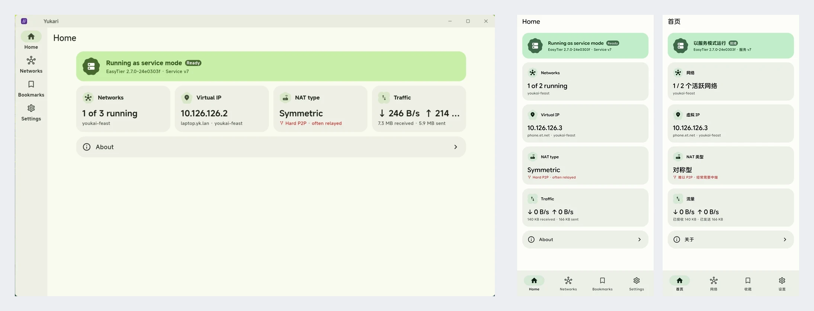

<p>
  <h1>Yukari</h1>
  
</p>

<p>
  <a href="https://github.com/SimonShiki/yukari/actions/workflows/ci.yml"></a>
  <a href="https://github.com/SimonShiki/yukari/releases"></a>
  <a href="./LICENSE"></a>
  
</p>

English | [简体中文](./README-zh.md)

A cross-platform decentralized networking app built on [EasyTier](https://github.com/EasyTier/EasyTier), for connecting your devices wherever they are.

Despite keeps Easytier's full functionality, this app spends its effort on the UX designs to make networking easier.

## Screenshots

<p align="center">
  
</p>

## Features

- **Cross-platform.** Windows, Linux and Android now and planned for Apple systems.
- **Service mode.** Network run as a system service, so the virtual network works without the app open. On Android, service mode runs through a KernelSU or Magisk module.
- **Networking easily.** Follow the prompts, and the app builds and manages the network.
- **All of EasyTier.** While keep a friendly UI, we still ships all EasyTier features and keeps compatability. An existing EasyTier network moves across as it is.
- **Easy toshare.** Send a network or a shared node to another device as an (animated) QR code. The other device scans it and joins with the peers and options you picked.

## Install

Please check [Releases](https://github.com/SimonShiki/yukari/releases) page.

## Building from source

```bash
flutter pub get
flutter gen-l10n
flutter build linux --release       # or windows, or apk
```

The EasyTier native library does not need a toolchain. A package hook downloads the library built from the current sources out of the `natives` release, and only compiles EasyTier itself when no published build matches the sources. A local build needs xmake and Rust.

On Linux, both the build and `flutter test` need the headers the native library links:

```bash
sudo apt-get install libgtk-3-dev libxi-dev libx11-dev libnotify-dev
```

`tool/package_linux.sh` turns the release bundle into the `.deb`, `.rpm`, pacman package and AppImage that a release publishes. `tool/pack_service_module.sh` builds the Android service module.

## Contributing

Read [CONTRIBUTING.md](./CONTRIBUTING.md).

## Licence

Yukari is released under the AGPL-3.0-only licence. See [LICENSE](./LICENSE) for the full text.

## Acknowledgements

- [EasyTier](https://github.com/EasyTier/EasyTier) does the networking. Yukari is a wrapper for it.
