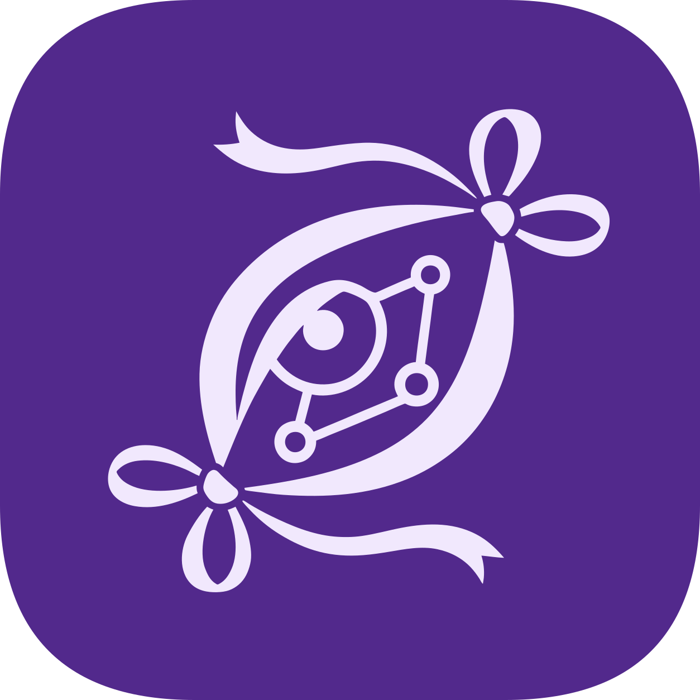

  <h1>Yukari</h1>
  

A cross-platform decentralized networking app based on [EasyTier](https://github.com/EasyTier/EasyTier), which can connect your devices everywhere ☯️.

Compared to the official client, this project is dedicated to improving UX while preserving EasyTier's full functionality, delivering a consistent and comfortable experience across all platforms.

**Tips:** This project is still in early development, and we don't provides any stable release yet.

## Features

- Cross-platform: Supports Windows, Linux and Android now, with platform-specific optimizations. iOS and macOS will be supported in the future.
- Service mode: Running actual network services as a system service, so that you can use your device as a server without keeping the app open. Android service mode is supported via KernelSU or Magisk module.
- Easy to create networks: You don't really need to learn computer networking knowledge, just follow the app's instructions to create and manage networks easily.
- Full EasyTier functionality: While improving UX, this project preserves all the features of EasyTier. You can seamlessly migrate existing EasyTier networks to this app.
- Share your network easily: You can share your network or shared nodes with your friends via existing network, link or QR code.
